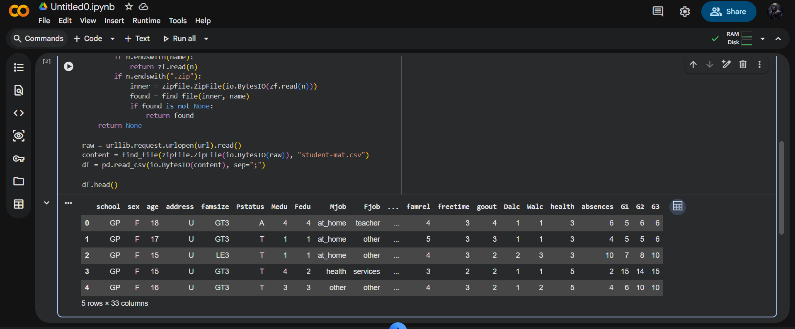
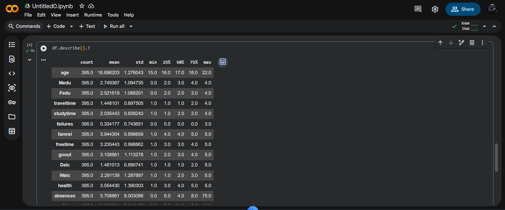
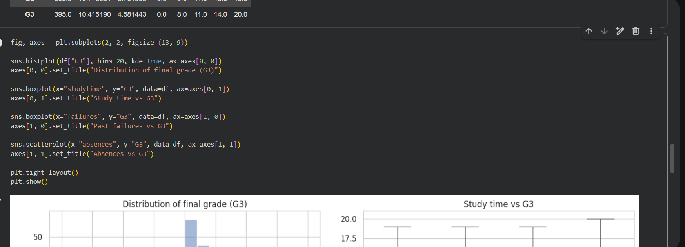
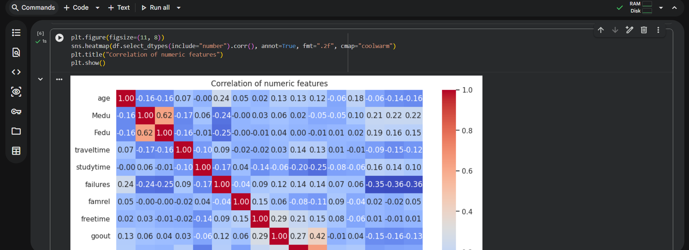
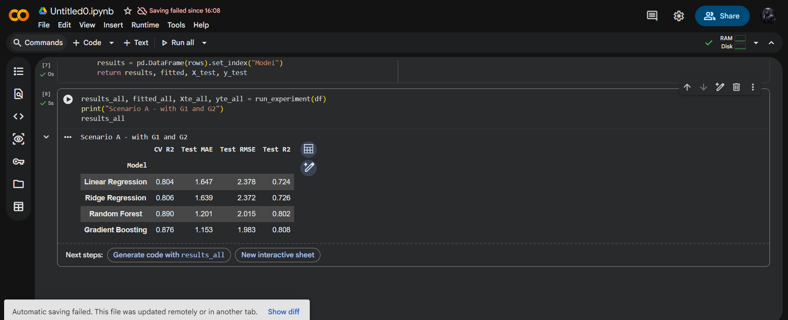
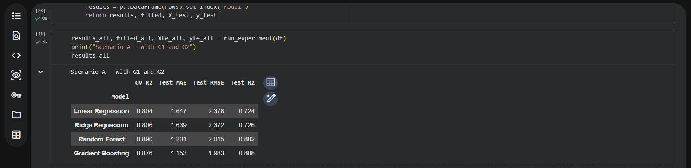

# Student Performance Prediction

An educational data mining project that predicts secondary school students' final mathematics examination grades ($G_3$) based on academic records, study habits, demographics, and social factors.

## 📌 Project Overview
Using the UCI Student Performance dataset (395 students, 33 attributes), this project implements a dual-scenario regression framework:
* **Scenario A (Comprehensive)**: Predicts final grade $G_3$ with prior term grades ($G_1, G_2$) included, reflecting end-of-semester forecasting.
* **Scenario B (Early Intervention)**: Predicts $G_3$ strictly using pre-exam indicators (study time, parental education, absences, school support), enabling early intervention for struggling students before any tests occur.

---

## 📊 Dataset & Pipeline
* **Target Variable**: $G_3$ (Final grade on a continuous 0–20 scale).
* **Preprocessing**: Built with `scikit-learn` `ColumnTransformer` and `Pipeline`:
  * Categorical variables: One-hot encoded with `drop='first'`.
  * Numerical variables: Standardized via `StandardScaler`.
* **Algorithms Evaluated**:
  1. Ordinary Least Squares (Linear Regression)
  2. Ridge Regression ($L_2$ regularization)
  3. Random Forest Regressor (`n_estimators=100`)
  4. Gradient Boosting Regressor (`n_estimators=100`, `learning_rate=0.05`)


*Figure 1: Loading UCI dataset and verifying data integrity.*


*Figure 2: Distribution of final grade G3 and study time correlations.*


*Figure 3: Scikit-learn preprocessing pipeline and ColumnTransformer setup.*

---

## 📈 Experimental Results

### Scenario Comparison ($R^2$ Scores)

| Algorithm | Scenario A (with $G_1, G_2$) $R^2$ | Scenario B (without $G_1, G_2$) $R^2$ | Test RMSE (Scenario B) |
| :--- | :---: | :---: | :---: |
| **Ridge Regression** | **0.824** | **0.252** | **3.81** |
| **Linear Regression** | 0.819 | 0.221 | 3.89 |
| **Gradient Boosting** | 0.805 | 0.245 | 3.83 |
| **Random Forest** | 0.791 | 0.238 | 3.85 |


*Figure 4: Model comparison between Scenario A and Scenario B.*


*Figure 5: Predicted vs actual final grade G3 scatter plot.*


*Figure 6: Residual error distribution showing near-zero mean.*

---

## 🎯 Key Insights
1. **Prior Academic History Dominates**: Term grades ($G_1, G_2$) explain over 82% of final grade variance.
2. **Early Prediction Value**: Even in the absence of prior test scores, demographic and behavioral factors (specifically past course failures, weekly study time, and mother's educational attainment) provide a reliable signal for identifying students at risk of failing ($G_3 < 10$).
3. **Regularization Benefit**: Ridge Regression achieved the best generalizability by penalizing collinear multi-category weights.

---

## 🚀 How to Run
```bash
git clone https://github.com/enoch1472/Student-Performance-Prediction.git
cd Student-Performance-Prediction

pip install pandas numpy matplotlib seaborn scikit-learn jupyter

jupyter notebook student_performance.ipynb
```

---
*Author: Enoch Obikoya*
